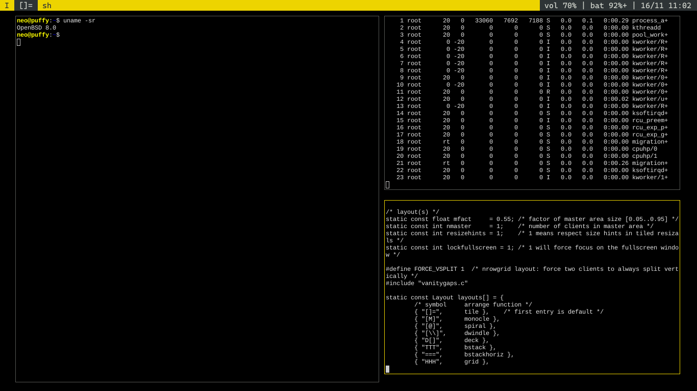
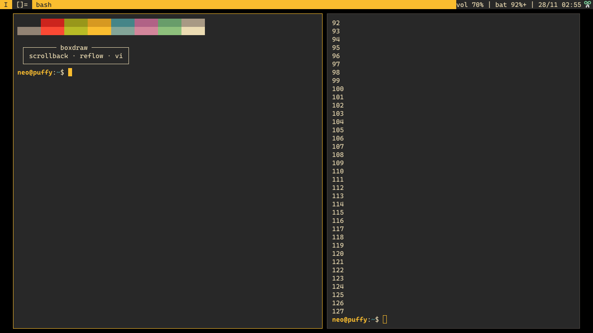

# dwm-config

dwm 6.4 para OpenBSD, em amarelo Tango (`#edd400` sobre `#2e3436`),
fonte Cascadia Code e áreas de trabalho em algarismos romanos (I a IX).



## Conteúdo

| Pasta / arquivo | O que é |
|---|---|
| `dwm/` | Código-fonte do dwm 6.4 com o `config.h` pronto. **Não é pacote do stow**: compila e instala |
| `st/` | st 0.9.3 (base [st-flexipatch](https://github.com/bakkeby/st-flexipatch)) com jeito de alacritty. Compila e instala |
| `install.sh` | Na raiz: instala pacotes, compila dwm e st e aplica o `x11` com o stow |
| `x11/` | Pacote do stow: `.xinitrc`, `.xsession` (xenodm), `.Xresources`, `bin/dwm-status` e `bin/printar` |
| `patches/` | Os diffs aplicados no dwm e no st, para reaplicar numa árvore limpa |
| `CORES.md` | Guia de todas as cores, para mexer sozinho |
| `dwm/movestack.c`, `dwm/vanitygaps.c` | Código trazido pelos patches |
| `LICENSE` | MIT/X, a mesma licença do dwm |

## Instalação

```sh
git clone https://github.com/snake-outerheaven/dwm-config ~/dwm-config
cd ~/dwm-config
sh install.sh -n     # simulação: mostra o que faria
sh install.sh        # instala de verdade
startx
```

O `install.sh` instala os pacotes essenciais (`dmenu`, `stow`), compila o `st` do repositório e os opcionais
(`git`, `vim`, `fastfetch`, `cascadia-code`, `feh`, `scrot`, `i3lock`, `xdg-user-dirs`), compila e instala o dwm e aplica o
pacote `x11` com o stow. Arquivos que já existirem no `$HOME` vão para
`~/.dotfiles-backup-DATA`; nada é apagado.

À mão:

```sh
doas pkg_delete dwm                  # se o dwm do pacote estiver instalado
cd dwm && make && doas make install
doas pkg_delete st                   # se o st do pacote estiver instalado
cd ../st && make && doas make install
cd .. && stow --no-folding x11       # ~/.xinitrc, ~/.xsession, ~/.Xresources, ~/bin/dwm-status
startx
```

O `config.mk` já usa os caminhos do OpenBSD (`${X11INC}/freetype2`).

### make do BSD ou GNU make

Os `Makefile` de `dwm/` e `st/` usam só sintaxe POSIX (`.POSIX:`), então
funcionam com o `make(1)` do OpenBSD e com o `gmake`. Testado com GNU make e
bmake: `all`, `install`, `clean` e `dist`.

```sh
make && doas make install          # make do OpenBSD
gmake && doas gmake install        # GNU make
```

Fora do OpenBSD, troque os caminhos na linha de comando (vale para os dois):

```sh
make X11INC=/usr/include X11LIB=/usr/lib FREETYPEINC=/usr/include/freetype2 KVMLIB=
```

## Patches aplicados

| Patch | Origem | O que muda |
|---|---|---|
| pertag | 6.4 | Cada área (I a IX) guarda o próprio layout, mfact e nmaster |
| vanitygaps | 6.4 | Espaço entre janelas e bordas; 13 layouts extras |
| attachbottom | 6.3, ajustado | Janela nova entra no fim da pilha, sem roubar a área principal |
| swallow | 6.3, ajustado | Programa gráfico aberto pelo `st` toma o lugar do terminal |
| togglefullscreen | 6.3 | Tela cheia em qualquer janela |
| hide_vacant_tags | à mão | A barra só mostra áreas ocupadas ou a atual |
| movestack | à mão | Move a janela para cima ou para baixo na pilha |

Diffs de referência: coleção [bakkeby/patches](https://github.com/bakkeby/patches)
(o site suckless.org tem as versões oficiais de cada um).

O swallow no OpenBSD usa `kvm_getprocs(3)` para achar o processo pai, por isso o
`config.mk` liga `-lkvm` e as bibliotecas `xcb`/`xcb-res` (todas no base do X).
Para desligar o swallow numa janela, use `noswallow = 1` na regra dela.

## st (terminal)



O dmenu fica como vem. O st foi ajustado para lembrar o alacritty:

| Recurso | Como usar |
|---|---|
| Histórico de 10 000 linhas | Roda do mouse, ou `Shift+PageUp` / `Shift+PageDown` |
| Reflow: o texto se reorganiza ao redimensionar | Automático |
| Copiar / colar | `Ctrl+Shift+c` / `Ctrl+Shift+v` (seleção vai direto para o clipboard) |
| Zoom da fonte | `Ctrl+=` / `Ctrl+-` / `Ctrl+0` |
| Modo vi (selecionar com o teclado) | `Ctrl+Shift+Espaço` ou `Ctrl+Shift+Esc` |
| Busca | `Ctrl+Shift+f` / `Ctrl+Shift+b` |
| Linhas e caixas desenhadas pelo st | Automático (boxdraw) |
| Cores Tango (cursor amarelo `#edd400`) | Do `config.h`; o `~/.Xresources` tem prioridade |

Patches ligados em `st/patches.h`: reflow, scrollback (+ mouse), clipboard,
keyboard_select, boxdraw, anysize e xresources. Para ligar ou desligar outro,
mude o `0`/`1` lá e recompile (`cd st && make && doas make install`).

## Wallpaper

O `.xinitrc` roda o `~/.fehbg` a cada sessão. Para escolher a imagem:

```sh
feh --bg-fill ~/flores.jpg    # mostra agora e grava o ~/.fehbg
```

Sem `~/.fehbg`, fica o fundo sólido `#2e3436`.

## Barra

O `~/bin/dwm-status` escreve na barra a cada 5 s: volume (`sndioctl`), bateria
(`apm`, ou os sensores ACPI quando o `apm` não responde) e data.
O `~/bin` é o lugar padrão do OpenBSD para scripts do usuário.

```sh
dwm-status -1        # imprime a linha uma vez, para testar
```

## Atalhos (Mod = Alt)

| Atalho | Ação |
|---|---|
| `Alt+Shift+Enter` | Terminal (`st`) |
| `Alt+p` | dmenu |
| `Alt+j` / `Alt+k` | Próxima / anterior janela |
| `Alt+Shift+j` / `Alt+Shift+k` | Move a janela na pilha (movestack) |
| `Alt+h` / `Alt+l` | Diminui / aumenta a área principal |
| `Alt+Enter` | Manda a janela para a área principal |
| `Alt+t` / `Alt+f` / `Alt+m` | Layout tile / flutuante / monocle |
| `Alt+y` | Tela cheia na janela atual |
| `Alt+Super+0` / `Alt+Super+Shift+0` | Liga/desliga os gaps / volta ao padrão |
| `Alt+Super+u` / `Alt+Super+Shift+u` | Aumenta / diminui todos os gaps |
| `Alt+1..9` / `Alt+Shift+1..9` | Ir para a área / mandar janela |
| `Print` / `Alt+Print` | Print da tela / de uma área, em `~/Downloads` (`printar`) |
| `Alt+Shift+x` | Bloqueia a tela (`i3lock`) |
| Teclas de volume | `sndioctl`: sobe, desce, mudo |
| Teclas de brilho | `xbacklight`: sobe, desce |
| `Alt+Shift+c` | Fecha a janela |
| `Alt+Shift+q` | Sai do dwm |

## Mudar algo

O dwm não tem arquivo de configuração em tempo de execução: edite `dwm/config.h`
e recompile.

```sh
cd ~/dwm-config/dwm && make && doas make install
```

Saia do dwm (`Alt+Shift+q`) e rode `startx` de novo. As cores estão explicadas em `CORES.md`.

## Referências

`dwm(1)`, `dmenu(1)`, `st(1)`, `xsetroot(1)`, `sndioctl(1)`, `apm(8)`, `stow(8)`.
